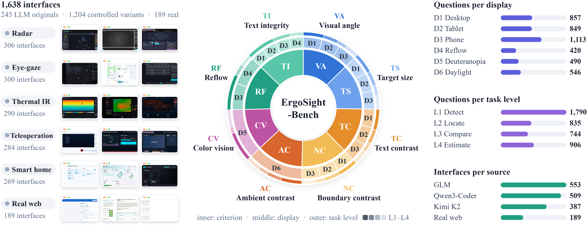

<h1>
  <p align=center> ErgoSight: Physically Grounded Evaluation of How Multimodal Large Language Models Perceive the Visual Ergonomics of User Interfaces </p>
<div align="center">


</div>
</h1>
<p align="center">
  
</p>

ErgoSight evaluates whether multimodal large language models (MLLMs) can judge the visual
ergonomics of a user interface under a specified display condition. The Physical Measurement
Oracle (PMO) renders every page under each display condition and derives every label from
measured physical quantities, such as the visual angle of text, the contrast of a control
boundary, and the contrast of text in daylight. The Physical View Lens (PVL) renders these
quantities as views that make them visible. Three input settings, the screenshot alone (S0), the
screenshot with the PVL views (S1), and the screenshot with the measured values (S2), attribute
every failure to the visibility of the quantity, to its perception, or to the application of the
threshold.

**Download.** [ErgoSight-Bench.zip](https://github.com/wanq501/ErgoSight/releases/latest) holds the
interface pages and the screenshots and Physical View Lens views of all 4,275 questions. Unpack it
into `data/` of this repository:

```shell
unzip ErgoSight-Bench.zip -d data
```

## Availability

This repository releases ErgoSight-Bench with the label and the measured value behind every question,
the replies of the eight evaluated MLLMs, the four prompts, and the code that recomputes the results
of the paper:

| File | Content |
|---|---|
| `ErgoSight-Bench.zip` (release asset) | The interface pages as HTML files and, for every question, the screenshot and the views shown in S0, S1, and S2 |
| `data/questions.jsonl` | The 4,275 questions with criterion, task level, display condition, options, label, measured value, subsets, position-swapped twin, the images shown in each setting, and the exact user prompt in S0, S1, and S2 |
| `data/answers.csv.gz` | All 66,261 replies of the eight MLLMs with tokens, latency, and cost per request |
| `data/criteria.csv`, `data/displays.csv`, `data/settings.csv`, `data/models.csv` | The eight criteria with their thresholds, the six display conditions, the input settings, and the evaluated models |
| `prompts/` | The generation, polish, repair, and question prompts |
| `ergosight/` | Loading of questions, replies, pages, and images, reply reading, and the metrics of the paper |
| `scripts/reproduce_tables.py` | Recomputes the main results of the paper |
| `scripts/reproduce_analyses.py` | Recomputes the additional analyses of the paper |
| `scripts/pack_dataset.py` | Builds `ErgoSight-Bench.zip` from an ErgoHMI export and checks it against `data/questions.jsonl` |

The interface generation pipeline, the measurement engine of the PMO, and the renderer of the
PVL views will be released upon publication.

## Verifying the results

```shell
git clone https://github.com/wanq501/ErgoSight.git
cd ErgoSight
pip install -r requirements.txt
python3 scripts/reproduce_tables.py
python3 scripts/reproduce_analyses.py
```

Both scripts read only the files in `data/`, write one CSV per result to `results/`, and print
the values. `reproduce_tables.py` recomputes the accuracy of every model per criterion, display
condition, task level, and page origin, the bootstrap intervals, the gains of S1 and S2 with the
exact McNemar test under Holm's correction, the view ablation, the error direction, and the
position consistency. `reproduce_analyses.py` recomputes the errors fixed by the measured values,
the page-level cluster bootstrap, the pairwise comparison of the eight models, the comparison of
real and generated pages on the core subset, the answers changed with and without a view, the
gains per type of view, the sensitivity of the visual angle labels to the cap-height ratio, and
the misses and false alarms of every model.

## Benchmark

ErgoSight-Bench contains 1,659 interfaces, 1,470 written by GLM-4.6, Qwen3-Coder, and Kimi K2 for
120 design briefs in five HMI domains and 189 real web pages from
[Design2Code](https://github.com/NoviScl/Design2Code). Its 4,275 questions are posed on 1,638 of
these interfaces at four task levels, detection (L1), localization (L2), comparison (L3), and
estimation (L4).

| ID | Criterion | Threshold | Source | Questions |
|---|---|---|---|---|
| TC | Text contrast | C ≥ 4.5 or 3.0 | WCAG 2.2 SC 1.4.3 | 536 |
| NC | Boundary contrast | C ≥ 3.0 | WCAG 2.2 SC 1.4.11 | 538 |
| VA | Visual angle | θ ≥ 16′ or 20′ | ISO 9241-303, FHWA | 538 |
| TS | Target size | 7.0 mm or 24 px | WCAG 2.2 SC 2.5.8, Apple | 542 |
| RF | Reflow | overflow ≤ 2 px | WCAG 2.2 SC 1.4.10 | 539 |
| TI | Text integrity | fully visible | WCAG 2.2 SC 1.4.10, 1.4.12 | 546 |
| CV | Color vision | ΔE<sub>D</sub> ≥ 10 | WCAG 2.2 SC 1.4.1, Machado et al. | 490 |
| AC | Ambient contrast | C<sub>a</sub> ≥ 3.0 | FHWA, Chen et al. | 546 |

| ID | Display condition | Physical parameters |
|---|---|---|
| D1 | Desktop | 24-inch monitor, 92 ppi, pixel ratio 1, 600 mm, mouse |
| D2 | Tablet | 11-inch tablet, 264 ppi, pixel ratio 2, 400 mm, touch |
| D3 | Phone | 6.1-inch phone, 460 ppi, pixel ratio 3, 300 mm, touch |
| D4 | Reflow | 320 CSS px window at 400% zoom |
| D5 | Deuteranopia | D2 layout seen with deuteranopia |
| D6 | Daylight | D3 under 10,000 lx, 600 cd/m², screen reflectance 4% |

After unpacking `ErgoSight-Bench.zip`, `data/` holds

```text
data/
├── questions.jsonl
├── answers.csv.gz
├── pages/<page_id>.html                      one HTML file per interface
└── images/<qid>/s0.jpg, loupe.jpg, ruler.jpg, sim.jpg
```

where `s0.jpg` is the screenshot under the display condition of the question and `loupe.jpg`,
`ruler.jpg`, and `sim.jpg` are the enlarged crop, the scale reference, and the viewer simulation
of the PVL. The field `inputs` of each question lists the images shown in each setting:

```python
from ergosight import load_questions, image_paths, page_path
q = load_questions()
print(image_paths('q00000', 'S1', questions=q))        # the images of question q00000 in S1
print(page_path(q.set_index('qid').loc['q00000', 'page_id']))
```

## Results

Accuracy (%) on the 891 questions of the core subset, which every model answers. The chance level
is 41.6%, and the 95% interval of S0 is a bootstrap percentile interval. S2 runs on Claude
Haiku 5.5 and the three local models.

| Model | S0 | 95% interval | S1 | S2 |
|---|---|---|---|---|
| Claude Sonnet 5.5 | **81.9** | 79.3–84.4 | **84.4** | |
| Gemini 3.8 Flash | 74.7 | 71.8–77.7 | 81.3 | |
| Claude Haiku 5.5 | 72.3 | 69.4–75.2 | 77.7 | **93.8** |
| GPT-5.4 mini | 67.2 | 64.1–70.3 | 68.7 | |
| Qwen3.5-397B-A17B | 53.9 | 50.6–57.1 | 60.6 | |
| Qwen3.5-9B | 48.6 | 45.2–51.9 | 51.2 | 89.0 |
| Qwen3-VL-8B-Instruct | 47.3 | 44.0–50.5 | 51.1 | 92.9 |
| InternVL3.5-8B | 45.6 | 42.3–48.8 | 52.2 | 86.3 |

## Runtime

| Item | Setting |
|---|---|
| GPU | NVIDIA RTX PRO 6000 with 96 GB for the three local models |
| Serving | vLLM OpenAI-compatible server for the local models; the proprietary models and Qwen3.5-397B-A17B through their APIs |
| Decoding | Temperature 0 and seed 0; low reasoning effort for the proprietary models and the thinking mode disabled for the Qwen3.5 models |
| Output limit | 4,096 tokens through the APIs and 1,536 tokens locally |
| Rendering | Headless Chromium at the viewport and device pixel ratio of each display condition |

## Citation

```bibtex
@article{wan2026ergosight,
  title   = {ErgoSight: Physically Grounded Evaluation of How Multimodal Large Language Models Perceive the Visual Ergonomics of User Interfaces},
  author  = {Wan, Qian},
  journal = {Displays},
  note    = {Under review},
  year    = {2026}
}
```

## License

This repository is released under the GNU Affero General Public License v3.0, see `LICENSE`. The
real web pages of ErgoSight-Bench come from Design2Code and remain subject to its license.

## Contact

Qian Wan, School of Computing and Artificial Intelligence, Southwest Jiaotong University,
qianwan1990@outlook.com
